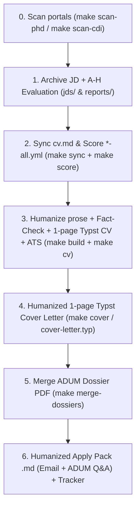

# End-to-End Application Workflow — Typst × `career-ops` × `humanizer`

This document describes the complete pipeline run by the agent (driven by `.agent/skills/typst-cv/SKILL.md`, `.agent/skills/humanizer/SKILL.md`, `.agents/skills/career-ops/SKILL.md`, `modes/_profile.md`, and `modes/_custom.md`): from portal scanning through fact-checked, humanized 1-page Typst PDFs and merged ADUM application dossiers.

---

## 1. Pipeline Overview



---

## 2. Sources of Truth, First-Time YAML Setup & Non-Negotiable Rules

### First-Time YAML Generation (Always Base on `*.example.yml`)
On a fresh setup (or whenever any gitignored personal YAML file does not exist yet), **always read and use the matching `*.example.yml` file as the structural blueprint** — never invent a YAML structure from scratch:

- **`content/yaml/info.yml`** ← base on **`content/yaml/info.example.yml`** (exact keys: `full_name`, `slug`, `email`, `phone`, `github`, `linkedin`, `location`, `city`, `availability`, and `school.{france,international,degree_default,degree_embedded}`).
- **`content/yaml/{experience,projects,skills,about,education}-all.yml`** ← base on **`content/yaml/*-all.example.yml`** (preserves the exact tagging schema expected by `select-from-bank.mjs` and `sync-cv-md.mjs`: `id`, `archetypes`, `tracks`, `tags`, `priority`, `max_items`/`max_skills`, `icon`, `status: done | in-progress | planned`, and `confirm_before_cv`).
- **`config/profile.yml`** ← base on **`config/profile.example.yml`** (validated by `validate-profile.mjs`).
- **`portals.yml` & `portals.cdi-vie.yml`** ← base on **`portals.example.yml`** and **`portals.cdi-vie.example.yml`** (validated by `validate-portals.mjs`).
- **`modes/_profile.md` & `modes/_custom.md`** ← base on **`modes/_profile.example.md`** and **`modes/_custom.example.md`**.
- **`content/typ/about.typ`** ← base on **`content/typ/about.example.typ`** (overwritten automatically on `--sync-default`).

After creating the personal YAML files from the `*.example.yml` templates, run `make sync && make doctor` to verify every schema and generate `cv.md`.

### User Layer (Gitignored — use `*.example.*` templates for setup)
All personal files are gitignored so the repository contains zero personal data. Every personal file has a sanitized `*.example.*` template tracked in git:

- **Personal identity & school metadata:**
  - `content/yaml/info.yml` *(template: `content/yaml/info.example.yml`)* — holds `full_name`, `slug`, `email`, `phone`, `github`, `linkedin`, `location`, `city`, `availability`, and `school` naming/degree rules (`france` vs `international`). Read directly by `main.typ`, `cover-letter.typ`, `sync-cv-md.mjs`, and `select-from-bank.mjs`.
- **Master CV bank (immutable single source of truth):**
  - `content/yaml/experience-all.yml` *(template: `experience-all.example.yml`)*
  - `content/yaml/projects-all.yml` *(template: `projects-all.example.yml`)*
  - `content/yaml/skills-all.yml` *(template: `skills-all.example.yml`)*
  - `content/yaml/about-all.yml` *(template: `about-all.example.yml`)*
  - `content/yaml/education-all.yml` *(template: `education-all.example.yml`)*
- **Generated active preview files (optional convenience slot for `make cv`, gitignored):**
  - `content/yaml/{experience,projects,skills,education}.yml` and `content/typ/about.typ` *(template: `about.example.typ`)*. Overwritten automatically by `select-from-bank.mjs apply --sync-default`; never edit manually.
- **Canonical Markdown CV (auto-generated, gitignored):** `cv.md` via `make sync` (`node scripts/typst/sync-cv-md.mjs`).
- **Profile & standing rules (gitignored):** `config/profile.yml`, `modes/_profile.md`, `modes/_custom.md` *(templates: `config/profile.example.yml`, `modes/_profile.example.md`, `modes/_custom.example.md`)*.
- **Portal scan configs (gitignored):** `portals.yml`, `portals.cdi-vie.yml` *(templates: `portals.example.yml`, `portals.cdi-vie.example.yml`)*.
- **Static PDF attachments for ADUM merging (gitignored):** `documents/notes.pdf` and optional `documents/recommandation.pdf`.

### Strict Honesty & Writing Quality Guardrails
1. **Zero fabrication:** Never invent tools, metrics, exact durations, or projects.
2. **Exclude `status: planned` by default:** Planned projects are never presented as completed work.
3. **Never list research watchlist items as skills:** Follow the watchlist exclusions in `modes/_profile.md`.
4. **Respect `in-progress` / `confirm_before_cv` flags:** Keep ongoing work clearly labeled as in progress; do not list unconfirmed skills as mastered without explicit confirmation.
5. **Accurate project attribution:** Describe personal utilities truthfully (never claim open-source maintainership unless backed by `cv.md`).
6. **Availability check:** Always verify offer start dates against `content/yaml/info.yml → availability` / `config/profile.yml → candidate.availability`.
7. **Mandatory Humanizer pass (`.agent/skills/humanizer/SKILL.md`):** Run `blader/humanizer` (embedded mode) on every generated or rewritten prose block — CV `about.yml`, edited bullets, `cover-letter.yml`, outreach emails, and ADUM form answers — to eliminate AI writing patterns without altering or inventing facts.
8. **Zero auto-submission:** Never click *Send* or *Submit* (neither email nor application portals).

---

## 3. Detailed Pipeline Steps

### Step 0 — Portal Scanning (`scan.mjs`)
Two separate portal configs keep PhD/CIFRE offers cleanly separated from industry roles:
- **PhD & CIFRE only (active default):** `make scan-phd` → reads `portals.yml` (`max_posting_age_days: 180`), excludes configured dealbreakers, non-PhD contracts (`cdi`, `stage`, `stagiaire`, `intern`, `post-doc`, `alternance`), and excluded regions.
  - **Zero-token local parsers (`scripts/parsers/`):** `doctorat-gouv.mjs` (national ADUM / `doctorat.gouv.fr` API), `inria-phd.mjs`, `cnrs-phd.mjs`, `cea-theses.mjs`, `onera-theses.mjs`, `abg-theses.mjs`.
  - **Direct ATS providers & WebSearch handoff:** Configured per-user in `portals.yml`.
- **Permanent roles (CDI France) & VIE only:** `make scan-cdi` → reads `portals.cdi-vie.yml` (`max_posting_age_days: 45`).
- New matches land under `## Pending` in `data/pipeline.md` (and move to `## Processed` once evaluated).

---

### Step 1 — JD Archival, A–H Evaluation & Gate Checks
1. Archive the verbatim posting text into `jds/{slug}.md`.
2. Run pre-work gates before investing tailoring effort:
   - Posting is still open and unassigned (`sujetAttribue: non`, deadline not passed).
   - **Funding & timeline eligibility:** Flag restricted funding (`CSC`, `MSCA COFUND` mobility rule, secured vs pending funding) and compare start date with candidate availability.
   - **Honest skill-gap check:** Run `node jd-skill-gap.mjs jds/{slug}.md --summary` and list real gaps transparently.
3. Write the full A–H evaluation report (`Blocks A–G`, plus `Block H` if score ≥ 4.5) in `reports/{NNN}-{company}-{YYYY-MM-DD}.md`.

---

### Step 2 — Master Bank Selection (`select-from-bank.mjs`) & Humanizer Pass
1. Sync `cv.md` from `content/yaml/*-all.yml` and `content/yaml/info.yml`:
   ```bash
   make sync
   ```
2. Score the master bank against the JD (5 archetypes × 3 tracks):
   ```bash
   make score JD=jds/{slug}.md OUT=output/bundles/{slug}/selection.json
   ```
   - **Archetypes:** `sched-agentic`, `inference-infra`, `platform-sre`, `network-5g6g`, `embedded-sec`.
   - **Tracks:** `cifre-phd`, `cdi-fr`, `vie`.
3. **Automatic rules applied in `selection.json`:**
   - **Language:** All PhD / CIFRE CVs (`cifre-phd`) are **100% English (`lang: en`)** — never mixed FR/EN.
   - **School naming (`market`):** Resolved from `content/yaml/info.yml → school.france` vs `school.international`.
   - **Conditional specialty suffix:** Uses `school.degree_embedded` for hardware/embedded/inference-compilation roles (`embedded-sec`, `inference-infra`), and `school.degree_default` for Cloud / Platform / Networking roles (`platform-sre`, `network-5g6g`, `sched-agentic`).
   - **Chronological integrity:** Experiences always keep the exact reverse-chronological order from `experience-all.yml`.
4. Refine `selection.json` (`about` summary, skill/project priorities), run **`.agent/skills/humanizer/SKILL.md`** on any rewritten prose to remove AI phrasing while preserving all facts, then materialize the bundle and sync the active preview slot:
   ```bash
   node scripts/typst/select-from-bank.mjs apply output/bundles/{slug}/selection.json \
     --out-dir output/bundles/{slug} \
     --sync-default
   ```

---

### Step 3 — Fact-Check, 1-Page Typst CV Build & Real-PDF ATS Audit (`build-typst-cv.mjs`)
```bash
make build \
  BUNDLE=output/bundles/{slug} \
  OUT=output/{NNN}-cv-{candidate-slug}-{company}-{YYYY-MM-DD}.pdf \
  JD=jds/{slug}.md \
  REPORT={NNN} \
  REPORT_FILE=reports/{NNN}-{company}-{YYYY-MM-DD}.md
```
`scripts/typst/build-typst-cv.mjs` automatically runs:
1. **Blocking fact gate (`verify-cv-facts.mjs`):** Fails (exit 2) if any claim in `cv-tailored.md` is unsupported by `cv.md`.
2. **Typst compilation (`main.typ`, `@preview/lavandula:0.1.1`, `--font-path font`).**
3. **Hard 1-page gate (`--max-pages 1`):** Fails (exit 3) and writes a `.overflow.pdf` draft if > 1 page → trim lower-priority bullets/projects in `selection.json`, re-run `apply --sync-default`, and rebuild until it fits on **exactly 1 page**.
4. **Real-PDF ATS keyword check:** Extracts text via `pdftotext` to `output/bundles/{slug}/cv-extracted.txt` and runs `keyword-match.mjs` against `--report-file` (falling back to `--jd-text jds/{slug}.md`).
5. **Deduplicated indexing (upsert)** in `data/pdf-index.tsv`.

Verify that the default preview `main.typ` also compiles cleanly on **1 page**:
```bash
make cv
```

---

### Step 4 — Humanized Typst Cover Letter (`cover-letter.typ`)
1. Draft `output/bundles/{slug}/cover-letter.yml`:
   - **100% English** for PhD/CIFRE, **strictly 1 page**.
   - **Flowing prose paragraphs only** (no bullets, no icons, no inline bold/colored text in the letter body).
   - Matching Lavandula visual identity (`#0EA5E9` / `#F0F9FF`, `Fira Sans`, `Font Awesome 7` header contact icons only, contact block read from `content/yaml/info.yml`).
2. Run **`.agent/skills/humanizer/SKILL.md`** on all paragraphs in `cover-letter.yml` to remove AI tells (not-X-but-Y contrasts, forced triads, em-dash overuse, inflated claims, stock AI buzzwords) while keeping every fact accurate.
3. Compile with strict 1-page verification:
   ```bash
   make cover \
     LETTER=output/bundles/{slug}/cover-letter.yml \
     OUT=output/{NNN}-cover-letter-{candidate-slug}-{company}-{YYYY-MM-DD}.pdf
   ```

---

### Step 5 — Single-PDF ADUM Dossier Merge (`merge-dossier.mjs`)
Lossless merge (`pdfunite`) in doctoral-school order:
1. `output/{NNN}-cv-*.pdf`
2. `output/{NNN}-cover-letter-*.pdf`
3. `documents/notes.pdf` (academic transcripts)
4. `documents/recommandation*.pdf` / `documents/recommendation*.pdf` *(auto-included whenever present in `documents/`)*

```bash
# Merge all offers in output/
make merge-dossiers

# Or merge a single offer with a specific reference letter
node scripts/typst/merge-dossier.mjs --id 002 --rec documents/recommandation.pdf
```

---

### Step 6 — Humanized Application Pack (`{NNN}-apply-*.md`) & Tracker (`data/applications.md`)
Generate `output/{NNN}-apply-{company}-{offer-id}.md` containing:
- **Attachment checklist** + direct portal/offer links.
- **Ready-to-send email draft** (`To`, `Subject`, `Body` — passed through `humanizer`, never auto-sent).
- **Mandatory ADUM form answers** (in French for French ADUM portals, passed through `humanizer` to sound authentic rather than template-generated, tailored to CIFRE vs Academic PhD).
- Update `data/applications.md` and move the checked `- [x]` entry from `## Pending` to `## Processed` in `data/pipeline.md`.

---

## 4. Repository Layout & `output/` Naming Convention

### Repository Layout
```text
.
├── main.typ / cover-letter.typ        # Typst templates (CV & cover letter, Lavandula theme)
├── Makefile / WORKFLOW.md / README.md # Shortcuts & documentation
├── doctor.mjs                         # Lightweight workflow health checker
├── portals.example.yml                # PhD/CIFRE portal config template (real portals.yml gitignored)
├── portals.cdi-vie.example.yml        # CDI/VIE portal config template (real portals.cdi-vie.yml gitignored)
├── config/profile.example.yml         # Profile template (real config/profile.yml gitignored)
├── content/
│   ├── yaml/info.example.yml          # Personal identity & contact template (real info.yml gitignored)
│   ├── yaml/*-all.example.yml         # Master CV bank templates (real *.yml gitignored)
│   └── typ/about.example.typ          # Active preview template (real about.typ gitignored)
├── .agent/skills/
│   ├── typst-cv/SKILL.md              # Tailored 1-page Typst CV skill
│   └── humanizer/SKILL.md             # blader/humanizer v4.0.0 de-AI-ification skill
├── .agents/skills/career-ops/SKILL.md # career-ops router skill
├── font/                              # Local fonts (Fira Sans + Font Awesome 7)
├── documents/                         # Gitignored static PDFs (notes.pdf, recommandation.pdf)
├── scripts/
│   ├── parsers/                       # Zero-token local PhD parsers (ADUM, Inria, CNRS, CEA, ONERA, ABG)
│   └── typst/                         # sync-cv-md.mjs, select-from-bank.mjs, build-typst-cv.mjs, merge-dossier.mjs
├── modes/                             # Core agent modes + _profile.example.md / _custom.example.md
├── jds/ / reports/ / data/            # Gitignored archived JDs, A-H reports, tracker & scan history
└── output/                            # Gitignored per-offer deliverables + Typst bundles
```

### Naming Convention inside `output/`
Every deliverable starts with the 3-digit offer ID (`{NNN}`) followed by the document type so all files for an offer stay grouped together:

```text
output/
├── 001-apply-{company}-{offer-id}.md
├── 001-cover-letter-{candidate-slug}-{company}-{YYYY-MM-DD}.pdf
├── 001-cv-{candidate-slug}-{company}-{YYYY-MM-DD}.pdf
├── 001-dossier-{candidate-slug}-{company}-{YYYY-MM-DD}.pdf
└── bundles/{slug}/
    ├── selection.json
    ├── cover-letter.yml
    ├── about.yml
    ├── experience.yml
    ├── projects.yml
    ├── skills.yml
    ├── education.yml
    ├── cv-tailored.md
    └── cv-extracted.txt
```

---

## 5. Quick Reference (`Makefile`)

| Command | Action |
|---|---|
| `make scan-phd` | Scan PhD & CIFRE postings only (`portals.yml`) |
| `make scan-cdi` | Scan CDI France & VIE postings only (`portals.cdi-vie.yml`) |
| `make sync` | Regenerate `cv.md` from `content/yaml/*-all.yml` and `content/yaml/info.yml` |
| `make score JD=... [OUT=...]` | Score the master YAML bank against a JD and emit `selection.json` |
| `make build BUNDLE=... OUT=... [JD=...] [REPORT=...]` | Fact-check + 1-page Typst CV build + real-PDF ATS audit + deduplicated index |
| `make cover LETTER=... OUT=...` | Compile a Typst cover letter and enforce the 1-page limit |
| `make cv` | Compile default `main.typ` → `cv.pdf` and enforce the 1-page limit |
| `make merge-dossiers` | Merge CV + cover letter + `documents/notes.pdf` (+ `documents/recommandation*.pdf` if present) |
| `make doctor` | Run workflow health checks (`doctor.mjs`, `validate-profile.mjs`, `validate-portals.mjs`) |
